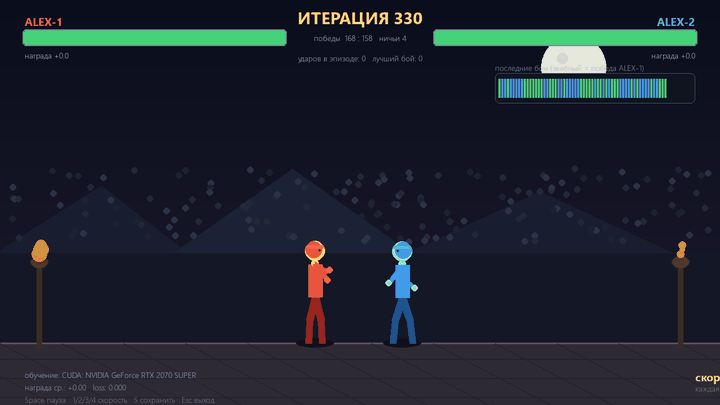
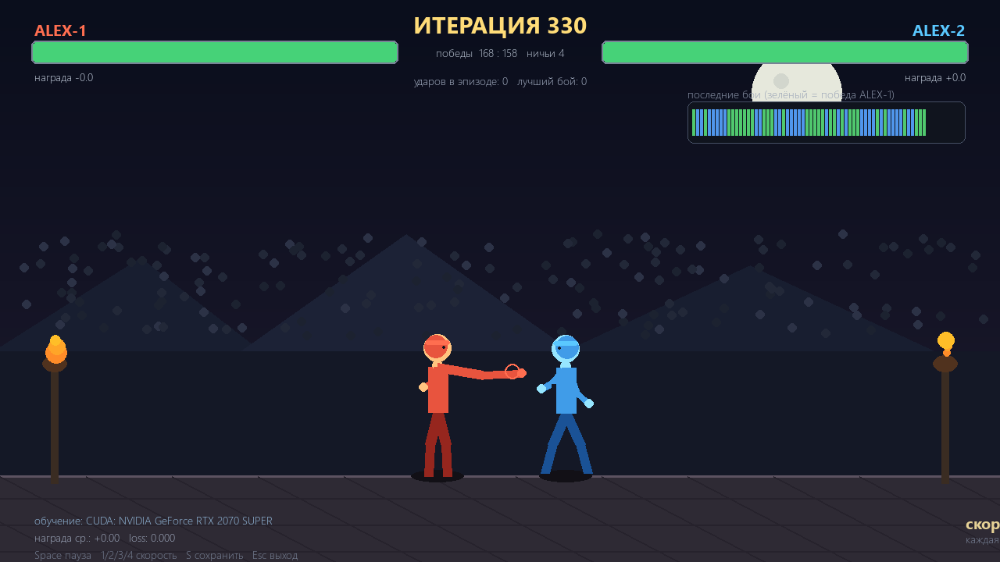
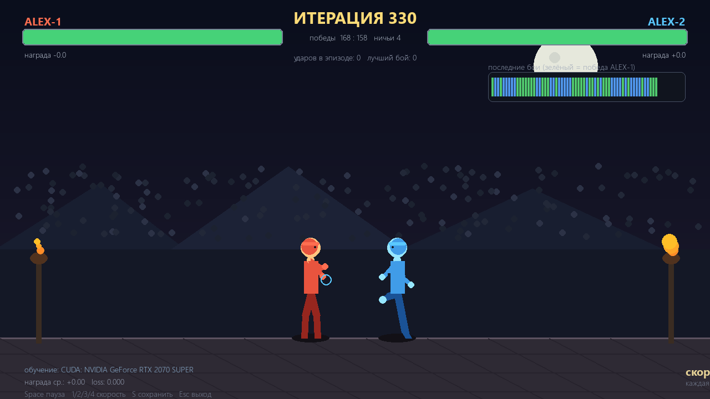
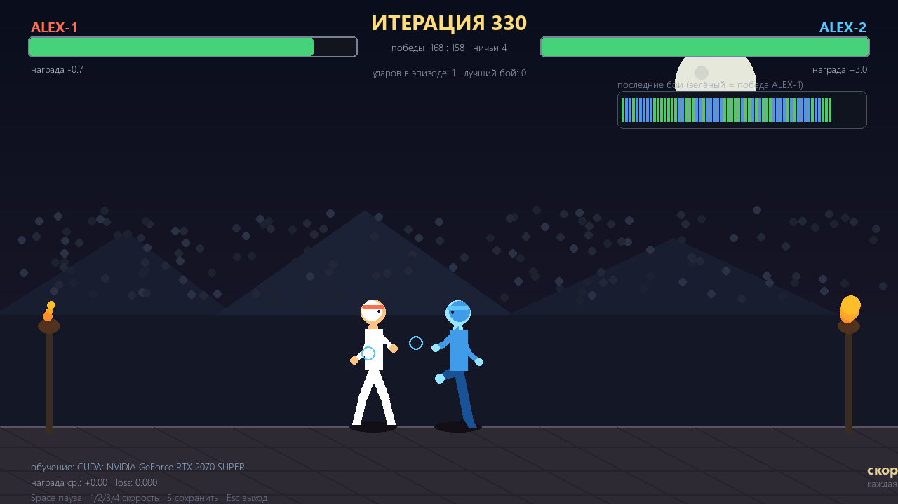
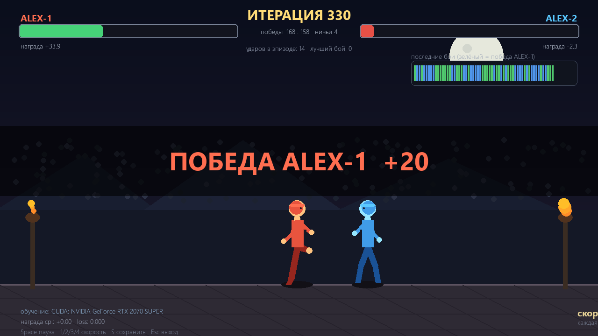

# MK-AI — два гуманоида учатся драться

<p align="center">
  
</p>

<p align="center">
  
  
  
  
</p>

2D-файтинг с видом сбоку, где **обоими бойцами управляет одна нейросеть**, которая
учится прямо во время боя. Один бой = одна попытка (эпизод): бойцы дерутся,
получают награды за удары и штрафы за простой, после чего веса политики
обновляются на GPU. Счётчик итераций и вся статистика обучения выводятся на экран.

Никаких скриптов поведения и захардкоженных комбо — только наблюдения, действия
и награды. Всё, что бойцы умеют, они выяснили сами.

---

## Содержание

- [Демо](#демо)
- [Быстрый старт](#быстрый-старт)
- [Управление](#управление)
- [Что видно на экране](#что-видно-на-экране)
- [Награды](#награды)
- [Как это работает](#как-это-работает)
- [Обучение из консоли](#обучение-из-консоли)
- [Результаты](#результаты)
- [Структура проекта](#структура-проекта)
- [Производительность](#производительность)
- [Ограничения и идеи](#ограничения-и-идеи)
- [Лицензия](#лицензия)

---

## Демо

| Удар рукой | Пинок |
|---|---|
|  |  |

| Размен ударами | Нокаут |
|---|---|
|  |  |

Полный бой в GIF: [`docs/screenshots/fight.gif`](docs/screenshots/fight.gif).
Скриншоты не нарисованы вручную — их собирает `tools/capture.py` из настоящих
кадров игры, снятых текущей обученной политикой.

---

## Быстрый старт

Нужен Python 3.10–3.12 и, желательно, GPU с CUDA (без GPU всё тоже работает,
просто медленнее).

### Windows

```powershell
git clone https://github.com/Chegolin123/mk-ai.git
cd mk-ai
python -m venv .venv
.\.venv\Scripts\python.exe -m pip install -r requirements.txt

# GPU-сборка PyTorch (CUDA 12.4). Для CPU просто: pip install torch
.\.venv\Scripts\python.exe -m pip install torch --index-url https://download.pytorch.org/whl/cu124

.\.venv\Scripts\python.exe game.py
```

### Linux / macOS

```bash
python3 -m venv .venv
source .venv/bin/activate
pip install -r requirements.txt
pip install torch --index-url https://download.pytorch.org/whl/cu124   # или обычный torch
python game.py
```

Если игра уже настроена (как на машине автора), достаточно `run.cmd` —
он запускает `game.py` интерпретатором из готового окружения.

### Проверка, что GPU используется

```bash
python -c "import torch; print(torch.__version__, torch.cuda.is_available(), torch.cuda.get_device_name(0))"
```

В нижней панели игры написано, на чём идёт обучение: `CUDA: <имя карты>` или `CPU`.

---

## Управление

| Клавиша | Действие |
|---|---|
| `Space` | пауза |
| `1` / `2` / `3` / `4` | скорость симуляции 1x / 2x / 4x / 8x |
| `S` | сохранить модель сейчас |
| `Esc` | выход (модель сохраняется автоматически) |

Скорость — это количество шагов физики за один кадр отрисовки. На 8x бой
пролетает почти мгновенно, зато итерации идут в 8 раз быстрее. Рендер при этом
не разгоняется: вы видите сменяющиеся кадры боя, а не замедленное кино.

---

## Что видно на экране

```
ИТЕРАЦИЯ 361                       ← сколько боёв проведено и обновлено
победы 184 : 173   ничьи 4         ← суммарный счёт за всё обучение
ударов в эпизоде: 18  лучший бой: 10
ALEX-1 ███████████░░░░░   ALEX-2 ██████████████░░
награда +34.6                      награда -6.9
...
обучение: CUDA: NVIDIA GeForce RTX 2070 SUPER
награда ср.: +23.59   loss: 7.346    скорость 4x
последние бои (зелёный = победа ALEX-1)
```

* **ИТЕРАЦИЯ** — главный счётчик: сколько эпизодов политика уже пережила.
  Растёт после каждого боя, потому что после каждого боя происходит шаг обучения.
* **награда эпизода** — накопленная награда каждого бойца в текущем бою.
* **loss** — значение функции потерь на последнем обновлении (policy + value).
* **история** — полоски исходов последних 60 боёв: зелёный — победа ALEX-1,
  синий — ALEX-2, серый — ничья.

---

## Награды

Награда — единственный канал обучения: нет ни примеров «правильных» действий,
ни скриптов. Формулировка в `game.py` (константы `R_*`):

| Событие | Награда |
|---|---|
| Попадание (удар рукой) | `+2.0 + 0.08 × урон` ≈ **+2.6** |
| Попадание (пинок) | `+2.0 + 0.08 × урон` ≈ **+3.0** |
| Удар пришёлся в блок | `+0.5` атакующему, `-0.1` защитнику |
| Пропущенный удар | `-0.6` |
| **2 секунды без ударов** | `-1.0`, и повторяется каждые 2 секунды простоя |
| Победа | **+20** |
| Поражение | **-8** |
| Ничья по таймеру | `-3` обоим |

Плюс слабый shaping (сотые доли за шаг), который нужен только чтобы случайная
политика вообще дошла до противника: шаг вперёд поощряется, шаг назад —
штрафуется, атака на дистанции удара поощряется, атака «в воздух» — нет.
Подробнее про то, как эти числа подбирались: [`docs/TRAINING.md`](docs/TRAINING.md).

---

## Как это работает

Коротко:

1. **Мир.** Два гуманоида на арене 1280×720. Гравитация, прыжки, толчки,
   дистанции ударов, урон, станы, блок. Шаг физики — 60 Гц.
2. **Решения.** Каждые 4 кадра (15 раз в секунду) каждый боец получает вектор
   из 18 чисел: своё и чужое здоровье, дистанция, высота, флаги атаки/блока,
   оставшееся время, время с последнего удара и т.д.
3. **Политика.** Небольшая MLP (18 → 128 → 128 → 7 действий + оценка ценности).
   Действия: стоять, шаг назад, шаг вперёд, прыжок, удар рукой, пинок, блок.
4. **Self-play.** Обе стороны играют одной и той же сетью: она учится на опыте
   обоих бойцов сразу.
5. **Обучение.** После каждого эпизода собираются траектории, считается
   discounted return, и политика обновляется actor-critic (A2C) на GPU:
   advantage нормируется, ценность учится MSE, энтропия поддерживает
   исследование.
6. **Сохранение.** Каждые 10 эпизодов и при выходе модель пишется в
   `models/policy.pt`; при старте она загружается, поэтому обучение продолжается
   с того же места.

Подробный разбор формул, вектора наблюдений, разрешения ударов и устройства
рендера: [`docs/ARCHITECTURE.md`](docs/ARCHITECTURE.md).

---

## Обучение из консоли

Без окна (быстрее, удобно для долгих прогонов и замеров):

```bash
python game.py --headless --episodes 200 --speed 8
```

Полезные флаги:

| Флаг | Смысл |
|---|---|
| `--headless` | без окна, только симуляция и обучение |
| `--episodes N` | сколько эпизодов провести в headless-режиме |
| `--speed 1\|2\|4\|8` | шагов физики за итерацию внешнего цикла |
| `--no-load` | не загружать `models/policy.pt`, начать с нуля |
| `--seed N` | сид для воспроизводимости |

Пример вывода:

```
эп   25  winner=1  hp  16.0:  0.0  hits 10+8  idle 2+3  R +41.73/ +7.22  loss 7.373  winrate 0.60
эп   30  winner=1  hp  19.0:  0.0  hits  9+7  idle 2+1  R +41.00/ +6.91  loss 10.014 winrate 0.67
[done] 40 эпизодов за 44.8 c (0.9 эп/с), средние удары 8.7, победы [28, 12, 0]
```

Обучение возобновляемое: остановите процесс в любой момент — прогресс уже
лежит в `models/policy.pt`. Хотите начать заново — удалите файл или
используйте `--no-load`.

---

## Результаты

Замер на RTX 2070 SUPER, headless, `--speed 8`, 40 эпизодов с нуля после
настройки наград:

| Метрика | Значение |
|---|---|
| Ударов за бой (в среднем) | **8.7** (было 0 — бойцы просто стояли) |
| Исходы | 28 : 12, ничьих **0** |
| Скорость | **0.9 эпизода/с** (≈ 1.5 с на бой вместе с обновлением весов) |
| Доля боёв с простоем ≥ 2 с | падает по ходу обучения |

Что видно по поведению:

* бойцы сближаются и бьют, а не стоят на месте;
* появились блоки и размены «удар — блок — контрудар»;
* пинок (дальний, но медленный) используется реже удара рукой — как и должно
  быть при такой награде за риск;
* бойцы научились добивать: нокдаун почти всегда до конца таймера.

Подробный журнал экспериментов (включая провальные конфигурации наград,
из-за которых бойцы предпочитали стоять) — в [`docs/TRAINING.md`](docs/TRAINING.md).

---

## Структура проекта

```
mk-ai/
├── game.py                  игра, физика, обучение и рендер (один файл)
├── run.cmd                  запуск окна на готовом окружении (Windows)
├── requirements.txt         зависимости
├── models/
│   └── policy.pt            сохранённая политика (обучается дальше с этого места)
├── tools/
│   └── capture.py           генерация скриншотов и GIF для документации
├── docs/
│   ├── ARCHITECTURE.md      как устроены среда, политика и обучение
│   ├── TRAINING.md          награды, эксперименты, метрики
│   └── screenshots/         скриншоты и анимация боя
└── README.md
```

---

## Производительность

| Что | Значение |
|---|---|
| Сеть | 18 → 128 → 128 → 7, ≈ 20 тыс. параметров |
| VRAM | ≈ 0.7 ГБ |
| Загрузка GPU | 30–40 % на RTX 2070 SUPER |
| Один эпизод (1200 кадров, до 2 обновлений) | ≈ 1.1 с headless |
| Окно с рендером на 4x | 3–6 эпизодов в минуту |

Маленькая сеть здесь не компромисс: состояние — это 18 чисел, а действий всего
семь. Большая модель просто переобучилась бы на 1200 кадрах одного боя.

---

## Ограничения и идеи

* Полностью наблюдаемая среда и симметричный self-play: бойцы не знают
  «характера» противника, обе стороны — одна и та же сеть.
* Нет истории (рекуррентности): политика марковская, помнит только то, что есть
  в 18 числах наблюдения.
* Счёт побед между ALEX-1 и ALEX-2 — не показатель мастерства, а артефакт
  зеркального self-play (порядок разрешения ударов чередуется по кадрам).
* Что можно добавить: PPO вместо A2C, популяцию политик (league play),
  рекуррентный слой, больше типов атак, звук и добивания.

---

## Лицензия

MIT — см. [LICENSE](LICENSE).
